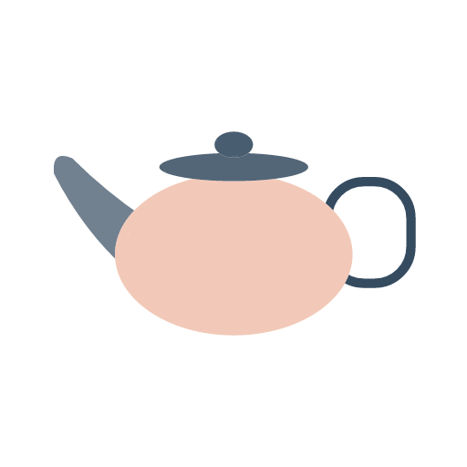

# 圆趣手绘

将人物、动漫角色、物品和旅行照片转换为灰蓝／蜜桃橘的正方形插画。模型读取原图，固定 SVG 引擎绘制宽圆面罩、胶囊眼和白纸留白，优先保证几何一致。

通过 `npx skills add` 安装，在 Codex 中使用 `$yuanqu-handdrawn` 调用。

## 安装

准备 Node.js **22.20 或更高**（满足当前 skills CLI 要求）、npm 和 Git。使用的 agent 需要能查看图片、读写文件和执行 Node.js 命令；首版主要面向 Codex。

本仓库为 **private**，安装者需要仓库访问权限和可用的 GitHub 身份认证。已有 Git 凭据或 SSH 配置可直接使用；使用 GitHub CLI 时，可先执行 `gh auth status` 检查，尚未登录则执行 `gh auth login`。

推荐全局安装，便于在不同项目中调用：

```bash
npx skills add CoffeeCheese/yuanqu-handdrawn-skills --skill yuanqu-handdrawn --agent codex --global --yes
```

仅安装到当前项目时，在目标项目目录执行：

```bash
npx skills add CoffeeCheese/yuanqu-handdrawn-skills --skill yuanqu-handdrawn --agent codex --yes
```

CLI 将技能放在全局 `~/.agents/skills/yuanqu-handdrawn/` 或项目内 `.agents/skills/yuanqu-handdrawn/`。HTTPS 认证不可用、已配置 GitHub SSH 的情况下，可改用：

```bash
npx skills add git@github.com:CoffeeCheese/yuanqu-handdrawn-skills.git --skill yuanqu-handdrawn --agent codex --global --yes
```

`skills add` 安装的是技能文件。首次生成 PNG 时，agent 会在实际安装目录运行 `npm ci --ignore-scripts --no-audit --no-fund`，准备锁定版本的 PNG 渲染器；无需图像生成 API 密钥或浏览器。首次依赖安装需要能访问 npm。

也可以提前手动准备全局安装的依赖：

```bash
npm --prefix "$HOME/.agents/skills/yuanqu-handdrawn" ci --ignore-scripts --no-audit --no-fund
```

## 使用

安装后提供一张原图，并发送：

```text
使用 $yuanqu-handdrawn 将这张原图转换为圆趣手绘插画。
保持原图的人物数量、发型、头朝向和遮挡，成品保存到 ./output/yuanqu-handdrawn/。
```

也可以明确指定多张原图或一个目录；目录默认只处理直属图片，每张独立生成和验收。仅需要分析时，说明“只分析，不生成”。

用户原图提供身份、姿势和场景内容；内置头像仅提供几何语言。默认输出一张 1024×1024 PNG，背景为白纸；每张最多一次数据修正。需要 JPG 时明确提出。

### 几何样例

以下是合成绘图数据的引擎预览，用于展示造型与配色，不是用户原图转换效果的证明。

| 人物肖像 | 闭眼动漫 | 物品 |
| --- | --- | --- |
|  |  |  |

## 支持内容

| 分支 | 构图与保留项 |
| --- | --- |
| 人物肖像 | 大头短肩，保留发型、必要配件、头向和真实遮挡 |
| 人形动漫 | 重建几何五官，钝化发束，保留闭眼、眼罩与背影 |
| 物品 | 保留轮廓、比例、关键构件和连接关系，无拟人化 |
| 有人的旅游照 | 保留主要旅行者及互动，背景概括为一个浅色地标 |
| 无人风景 | 用 3–7 个圆润块面保留地标或空间结构，不添加人物 |

完整规范见 [技能入口](skills/yuanqu-handdrawn/SKILL.md)、[风格规则](skills/yuanqu-handdrawn/references/style.md) 和 [构图规则](skills/yuanqu-handdrawn/references/compositions.md)。

## 查看、更新与移除

全局安装对应以下命令：

```bash
# 查看全局 Codex 技能
npx skills list --global --agent codex

# 更新这一项技能
npx skills update yuanqu-handdrawn --global --yes

# 移除这一项技能
npx skills remove yuanqu-handdrawn --global --agent codex --yes
```

项目安装的查看和移除命令去掉 `--global`；更新用 `npx skills update yuanqu-handdrawn --project --yes`。更新可能替换整个技能目录，下一次生成 PNG 时会重新准备缺失的依赖。

安装和管理规则参考 [skills CLI 官方说明](https://github.com/vercel-labs/skills)。本轮流程使用 CLI `1.7.1` 验证；需要固定同一 CLI 版本时，将 `npx skills` 替换为 `npx skills@1.7.1`。

## 输出与可复现性

默认保存到当前工作目录的 `output/yuanqu-handdrawn/`，也可指定其它目录。重名自动编号，每张保留：

- `.png`：发布与预览用成品。
- `.svg`：可编辑的几何图形。
- `.scene.json`：规范化绘图数据和纹理种子。
- `.report.json`：几何校验、版本和原图核对结果。
- `.analysis.md`：本次识别指令与观察记录。

固定绘图数据、种子、引擎版本和渲染环境后可复现；重新识别原图可能得到不同数据。模型负责识别身份与遮挡，程序负责几何规则；通过几何校验仍需核对原图，复杂发型与多人互动可能需要修正。旅游与风景已有离线样例，尚无用户原图实测基线。

## 开发

```bash
git clone git@github.com:CoffeeCheese/yuanqu-handdrawn-skills.git
cd yuanqu-handdrawn-skills/skills/yuanqu-handdrawn
npm ci --ignore-scripts --no-audit --no-fund
npm test

# 使用合成数据导出一份预览
node scripts/render.mjs references/examples/portrait.json --out-dir ../../output/demo
```

SVG 生成和数据校验的引擎本身支持 Node.js 20 或更高。当前测试覆盖五类分支、胶囊比例、遮挡、闭眼、白边、色系、可重复 PNG 与重名保护。

技能的脚本、参考图、规则、示例、依赖清单和 MIT 许可均位于 [skills/yuanqu-handdrawn/](skills/yuanqu-handdrawn/)，安装后不依赖源码仓库的其它目录。

## 许可证

采用 [MIT 许可证](LICENSE)。本项目是原创融合风格实验，不是官方 Grok 素材。
