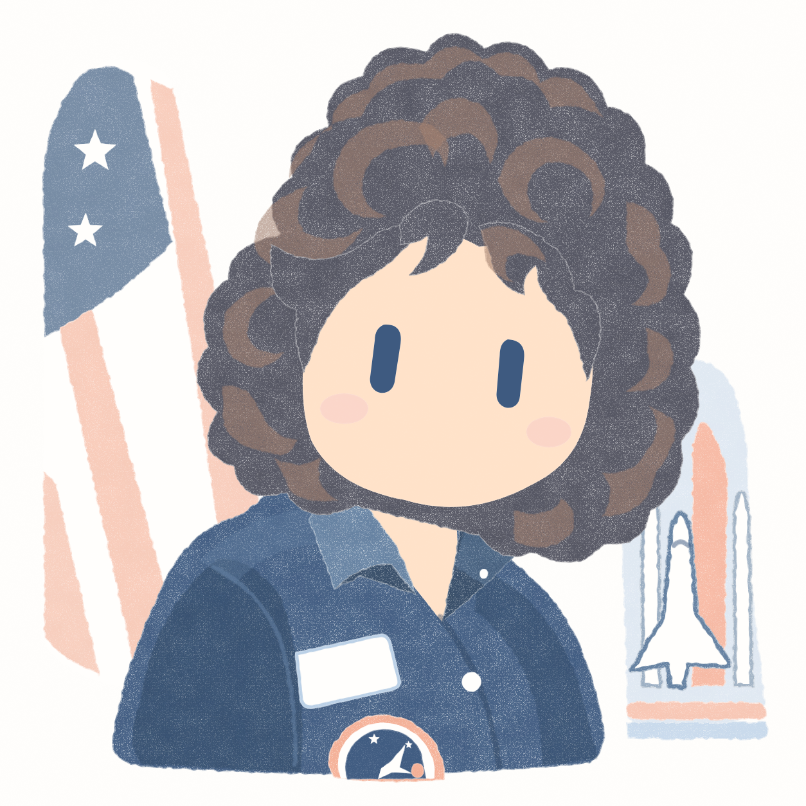

# 圆趣手绘

把照片或动漫原图转换为灰蓝／蜜桃橘、胶囊眼和白纸留白的正方形手绘插画。当前模型理解原图与风格参考，优先使用会话内置图像生成完成绘制。

流程关注风格、身份和姿态：优先内置图像生成；会话没有该能力时自动使用本地 **JS + Canvas**。当前模型负责看图与构图，Canvas 负责自由曲线、叠色和分区干性颜料，不强制固定脸型或眼距，不通过 SVG 中转。两种方式都不配置外部图像 API 或密钥。

## 安装

通过 `npx skills add` 管理，在 Codex 中使用 `$yuanqu-handdrawn` 调用。准备 Node.js 22.20 或更高、npm 和 Git；运行环境需要能查看图片、保存文件。内置图像生成可选，缺少时使用 Canvas 备用流程。

本仓库为 **private**，安装者需有访问权限及可用的 GitHub 认证。已有 Git 凭据或 SSH 配置可直接使用；GitHub CLI 用户可先执行 `gh auth status` 检查登录。

推荐全局安装：

```bash
npx skills add CoffeeCheese/yuanqu-handdrawn-skills --skill yuanqu-handdrawn --agent codex --global --yes
```

只安装到当前项目时去掉 `--global`。技能位于全局 `~/.agents/skills/yuanqu-handdrawn/` 或项目内 `.agents/skills/yuanqu-handdrawn/`。

HTTPS 认证不可用、已配置 GitHub SSH 时可使用：

```bash
npx skills add git@github.com:CoffeeCheese/yuanqu-handdrawn-skills.git --skill yuanqu-handdrawn --agent codex --global --yes
```

内置模型生成无需安装本仓库的 npm 渲染依赖。安装 skill 不会为会话增加图像能力；Canvas 分支首次执行时在实际技能目录运行 `npm ci --ignore-scripts --no-audit --no-fund`。安装依赖需要 npm 网络或缓存，之后渲染离线，不调用外部模型。

## 使用

提供原图后发送：

```text
使用 $yuanqu-handdrawn 将这张原图转换为圆趣手绘插画。
保留人物数量、发型、头朝向、姿态和真实遮挡，输出根目录使用 ./yuanqu-handdrawn/。
```

有自己认可的风格成品时，同时提供并明确角色：

```text
使用 $yuanqu-handdrawn：图1是原图，图2只作为风格参考。
尽量接近图2的配色、圆润造型和蜡笔笔触，人物身份与姿势以图1为准。
优先使用会话内置图像生成，保存到指定目录。
```

也接受多张原图或一个目录；目录默认只处理直属图片，每张独立生成和核对。只需分析时说明“只分析，不生成”。

未指定风格图时，从同一套包内历史成品选择题材接近的一张；航天服、卷发工作服、西装道具各有参考，其余使用下图。选择规则见 [风格校准](skills/yuanqu-handdrawn/references/style-calibration.md)。这些图片用于表达目标，不是新规则的生成测试结果：


## 风格与构图

柔和圆脸、醒目的实心竖胶囊眼、干净的脸部留白，配合连续发块、蜡笔／彩铅颗粒和自然边缘。灰蓝和蜜桃为主，必要识别配件允许少量低饱和辅助色。完整要求见 [技能入口](skills/yuanqu-handdrawn/SKILL.md)。

风格参考还控制造型尺度、颜料浓度、分区材质和边缘。包内成品的脸部近似干净平涂，衣发有自然疏密的干性颜料与宽笔触；白衣保留可读灰蓝结构，必要旗帜和模型可组成浅色背景。生成后按 [风格校准](skills/yuanqu-handdrawn/references/style-calibration.md) 分项比较，参考人物的朝向、配件和动作仍不移植。

| 输入 | 构图依据 |
| --- | --- |
| 人物或人形动漫 | 保留发型、配件、头向、闭眼与遮挡；头像用头肩构图，必要坐姿、双手与服装可保留 |
| 有人的旅游照 | 保留主要旅行者、互动及一个浅色场景线索 |
| 无人风景或物品 | 保留可辨的空间或物品结构，保持原图内容与无拟人化 |

## 输出与稳定性

默认请求一张 1:1、1024×1024 的纯插画，记录工具实际生成尺寸。默认输出根为当前目录的 `yuanqu-handdrawn/`；指定普通目标目录时在其中建立同名目录。指定该同名目录或明确指定其它输出根时直接采用，不重复嵌套。具体规则见 [输出目录](skills/yuanqu-handdrawn/references/output-layout.md)。

```text
yuanqu-handdrawn/
├── images/       成品 PNG／JPG
├── records/      生成指令、观察及核对记录
├── source/       Canvas HTML、绘图数据与实际源码；历史模式的 SVG
└── work/         按任务保存的候选或临时文件，按需创建
```

模型生成保存 `images/<原图名>-yuanqu.png` 和 `records/<原图名>-yuanqu.generation.md`。Canvas 将 scene／自包含 HTML 放 `source/`，report／analysis 放 `records/`。同一成品的关联文件共享名称，重名时整组编号。没有产生源码时无需建立 `source/`。

例如，目标目录为 `/Users/dengs/Desktop/自媒体/redBook/` 时，成品位于其下的 `yuanqu-handdrawn/images/`，记录位于 `yuanqu-handdrawn/records/`。用户明确选择的旧 `output/` 仍受支持；默认命名变更不会自动移动历史文件，整理已有目录时同步修正记录路径。

每张先生成一次，有具体偏差时最多修正一次；仍有偏差会说明。未核对成品时不记为通过。用户可继续提出下一轮修改。

系列稳定性依靠同一套认可参考、同类主体固定参考选择、核心要求和生成后核对。内置生成不保证重生成逐像素一致；Canvas 固定 scene、种子、尺寸和运行环境后可重复生成相同 PNG，重新识别与拟合仍可能变化。已试验坐姿肖像、动漫角色及四张人物原图，并对卷发工作服和白色航天服完成了模型重试与 Canvas 实图对照；风格仍有差异，不等同于用户确认通过。

## 更新与移除

```bash
# 查看全局 Codex 技能
npx skills list --global --agent codex

# 更新这一项技能
npx skills update yuanqu-handdrawn --global --yes

# 更新失败时，重新执行安装命令替换技能文件
npx skills add CoffeeCheese/yuanqu-handdrawn-skills --skill yuanqu-handdrawn --agent codex --global --yes

# 移除
npx skills remove yuanqu-handdrawn --global --agent codex --yes
```

项目安装的查看和移除去掉 `--global`；更新使用 `--project`。更新前将个人改动和输出保存在技能目录之外。安装命令参考 [skills CLI 官方说明](https://github.com/vercel-labs/skills)，本仓库此前使用 CLI 1.7.1 验证。

## 无图像生成时的 Canvas 备用流程

无需额外确认，skill 在能力缺失时说明采用 Canvas，并继续看图、编排数据、绘制、核对与保存。也可以主动选择：

```text
使用 $yuanqu-handdrawn，用本地 JS + Canvas 绘制这张原图，
图2只作为风格参考；保留真实遮挡，保存到指定目录。
```

新分支使用 V3 scene，脸部与衣发采用不同材质，胶囊眼保持实心，干笔方向、疏密与轮廓起伏由固定种子控制。宽笔触和衣纹由模型按原图编排曲线；脚本不自行识别照片。采用锁定的 [@napi-rs/canvas](https://github.com/Brooooooklyn/canvas) 在 Node 中导出 PNG，同时保存可直接离线打开的 HTML。详细数据与操作见 [Canvas 备用绘制](skills/yuanqu-handdrawn/references/canvas-fallback.md)。

复绘包内样例：

```bash
cd skills/yuanqu-handdrawn
npm ci --ignore-scripts --no-audit --no-fund
node scripts/render.mjs references/examples/canvas-curly-hair.json --size 1254
node scripts/render.mjs references/examples/canvas-eva-suit.json --size 1254
```

样例表达两张实图的拟合，不能直接套成其它人物：

| 卷发工作服 Canvas 样张 | 白色航天服 Canvas 样张 |
| --- | --- |
|  |  |

与最近两张模型生成图相比，Canvas 能保持圆脸胶囊、分区材质、白衣结构及必要场景，但轮廓更规整、卷发与衣纹更概括、笔触分布更均匀，尚未达到相同完成度。两种后端不会被记作完全相同的画法；继续调整时复用已保存的数据。

已有 V2 scene 按 [历史代码手绘](skills/yuanqu-handdrawn/references/code-handdrawn.md) 复绘；明确要求固定几何复现时使用 [固定几何流程](skills/yuanqu-handdrawn/references/legacy-geometry.md)。旧文件继续兼容，其比例规则不进入 V3 或默认模型生成。

## 设计与开发

按 `codebase-design` 将规则收拢为一个 Module：

| 设计概念 | 本项目的选择 |
| --- | --- |
| Interface | 原图＋可选风格参考＋可选输出目录，返回成品与生成记录 |
| Implementation | 参考角色、识别与风格要求、后端选择、核对、一次修正及保存集中在技能内部 |
| Seam | 生成执行处：根据会话实际能力与用户选择执行 |
| Adapter | 内置图像生成与本地 JS + Canvas；V1/V2 供历史数据复绘 |

Depth 来自小 Interface 隐藏识别、风格约束和交付细节；Leverage 是不同图片复用同一流程，Locality 是共用规则集中在 [SKILL.md](skills/yuanqu-handdrawn/SKILL.md)。工具参数放在 [内置生成约定](skills/yuanqu-handdrawn/references/model-generation.md)，Canvas 数据和材质放在其分支参考。Node 与导出的 HTML 执行同一份 Canvas 核心代码。

修改规则时检查参考图只影响风格，能力缺失能到达 Canvas 分支，执行方式如实记录。新分支与历史渲染均有回归检查：

```bash
cd skills/yuanqu-handdrawn
npm ci --ignore-scripts --no-audit --no-fund
npm test
```

测试验证复绘、分区材质、遮挡、数据合法性、HTML 导出和输出文件分组，不替代视觉审核。图像效果仍以实际原图与参考逐例比较。

## 许可证

采用 [MIT 许可证](LICENSE)。本项目是原创融合风格实验，不是官方 Grok 素材。
