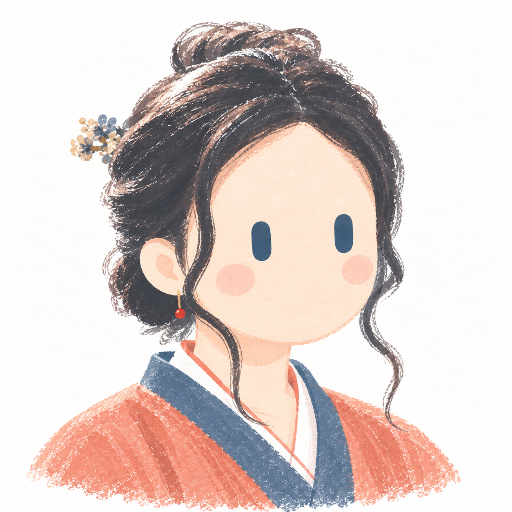
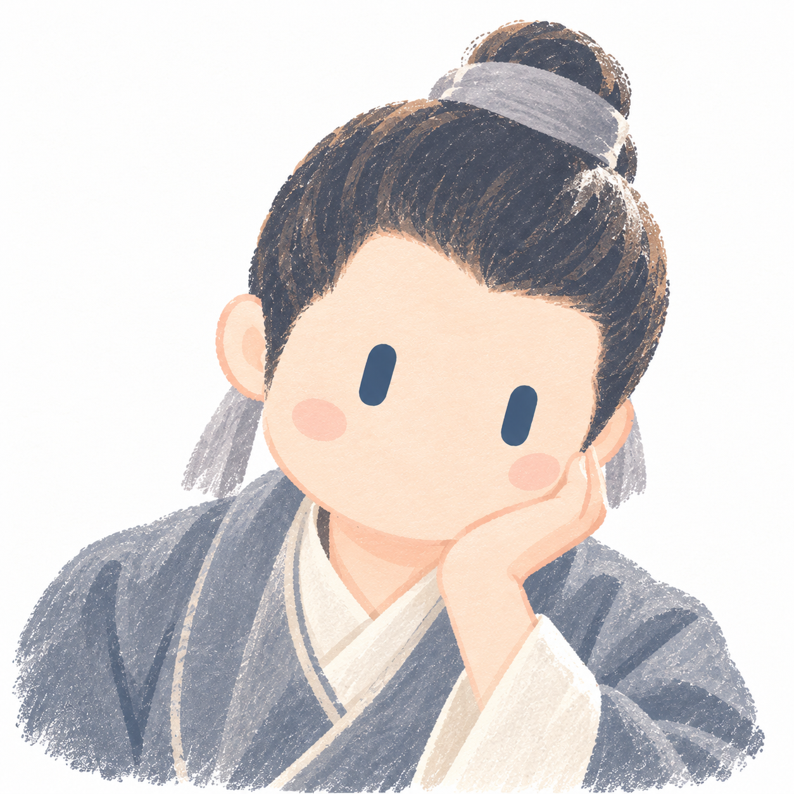
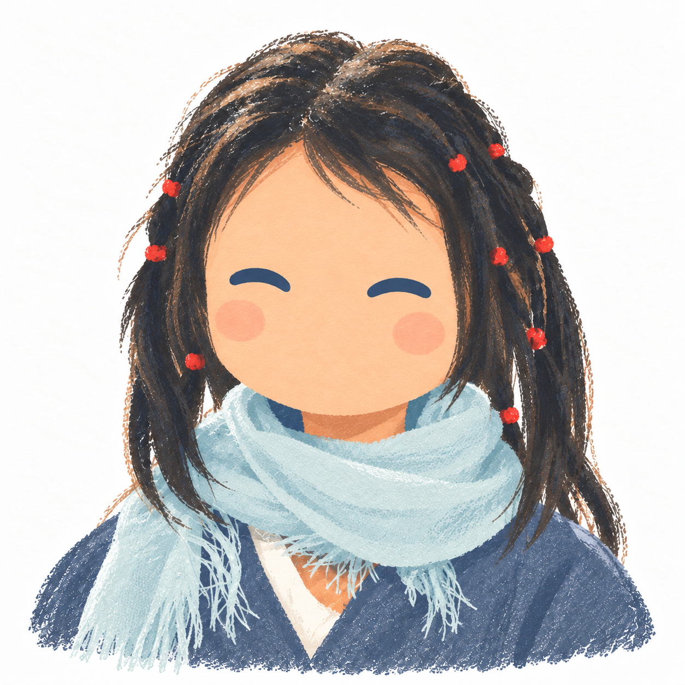
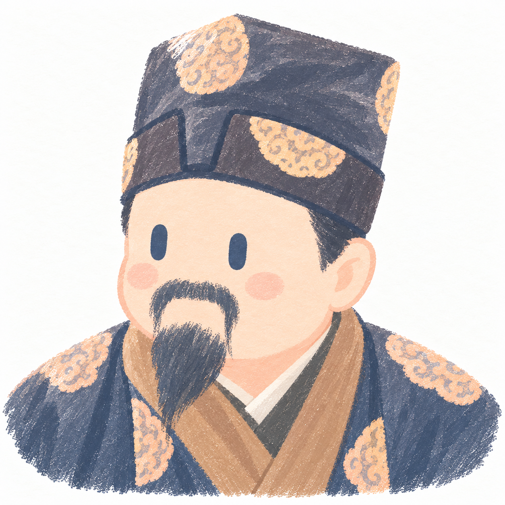
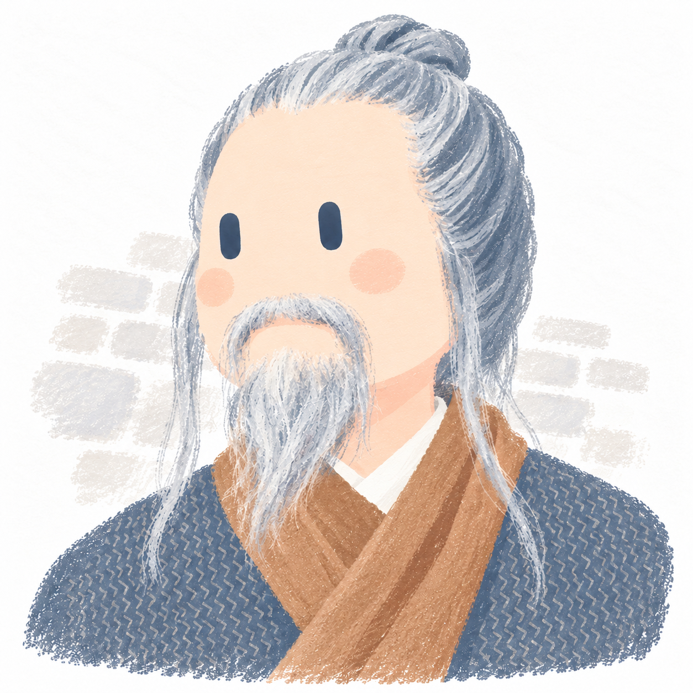
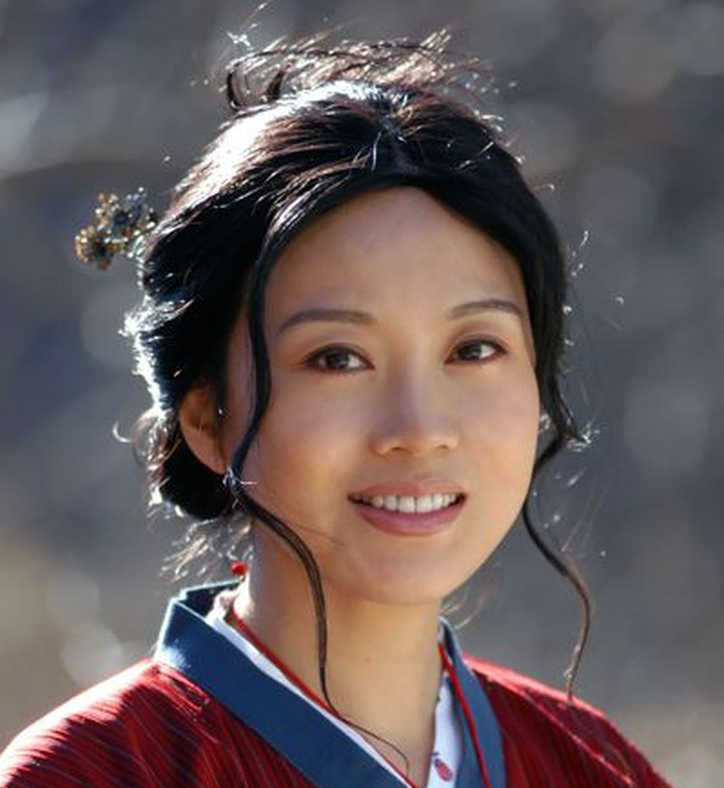
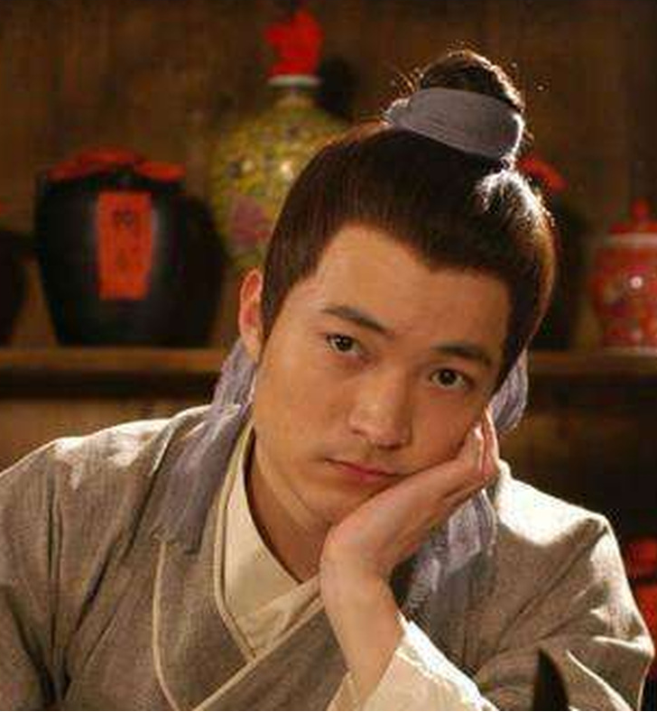
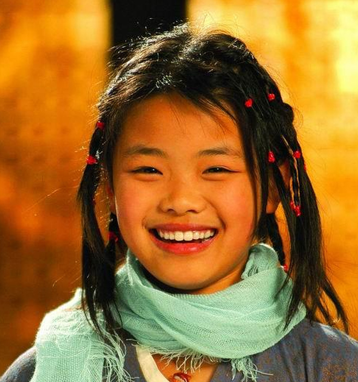
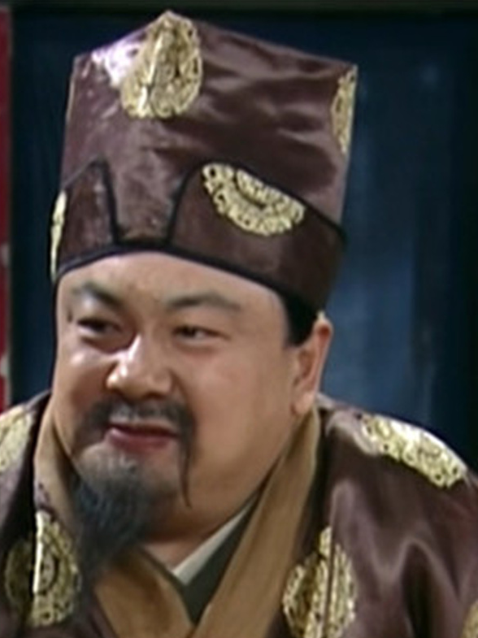
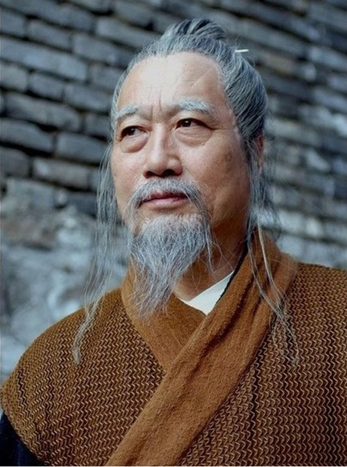

# 圆趣手绘

<p align="center">
  <a href="assets/examples/wulin-waizhuan/images/01-tong-xiangyu-yuanqu.png"></a>
  <a href="assets/examples/wulin-waizhuan/images/04-lv-xiucai-yuanqu.png"></a>
  <a href="assets/examples/wulin-waizhuan/images/07-mo-xiaobei-yuanqu.png"></a>
  <a href="assets/examples/wulin-waizhuan/images/12-qian-zhanggui-yuanqu.png"></a>
  <a href="assets/examples/wulin-waizhuan/images/19-gongsun-wulong-yuanqu.png"></a>
</p>

把照片或动漫原图画成圆脸、胶囊眼的手绘插画。灰蓝和蜜桃橘铺出大色块，衣发带着干笔纹理，四周留出白纸。人物的发型、服装、头向、动作和真实遮挡会保留下来，适合做头像或一组人物插画。

提供原图就能开始。模型负责看图和安排构图，优先使用会话内置图像生成；没有图像生成能力时，会自动改用本地 JS + Canvas。两种方式都不需要配置外部图像 API 或密钥。

<p align="center">
  <a href="#examples">看效果</a> · <a href="#install">安装</a> · <a href="#usage">开始使用</a> · <a href="#output">查看输出</a>
</p>

<a id="examples"></a>

## 实际效果：原图 → 圆趣手绘

这 5 张插画于 2026-10-12 使用本仓库 skill 生成。左列原图从《武林外传》四组对照长图左侧裁出，右列是这次重新生成的成品。五张图都使用会话内置图像生成，并沿用同一张[包内风格参考](skills/yuanqu-handdrawn/assets/handdrawn-reference.jpg)，实际输出为 1254×1254 PNG。

| 原图 | 圆趣手绘 |
| :---: | :---: |
| <br>**佟湘玉** | <br>盘发、花饰与垂落鬓发 · [生成记录](assets/examples/wulin-waizhuan/records/01-tong-xiangyu-yuanqu.generation.md) |
| <br>**吕秀才** | <br>歪头、单手托腮与遮挡 · [生成记录](assets/examples/wulin-waizhuan/records/04-lv-xiucai-yuanqu.generation.md) |
| <br>**莫小贝** | <br>眯眼、细辫与围巾流苏 · [生成记录](assets/examples/wulin-waizhuan/records/07-mo-xiaobei-yuanqu.generation.md) |
| <br>**钱掌柜** | <br>高帽、衣饰与深色山羊胡 · [生成记录](assets/examples/wulin-waizhuan/records/12-qian-zhanggui-yuanqu.generation.md) |
| <br>**公孙乌龙** | <br>三分之四头向、灰发与长须 · [生成记录](assets/examples/wulin-waizhuan/records/19-gongsun-wulong-yuanqu.generation.md) |

[查看完整对比长图](assets/examples/wulin-waizhuan/comparison.jpg) · [原图与成品目录](assets/examples/wulin-waizhuan/) · [来源及裁剪坐标](assets/examples/wulin-waizhuan/records/sources.json)

佟湘玉、吕秀才和钱掌柜各生成了 1 次。莫小贝和公孙乌龙各修正了 1 次，去掉补出的耳朵或发簪，并调整脸部纹理。成品已逐张核对，头发仍有偏暖、部分衣纹和胡须偏细碎的问题，各张生成记录里有具体说明。这里展示的是这次生成的效果，重新生成可能不同。

<a id="install"></a>

## 安装

使用前准备好 Node.js 22.20 或更高版本、npm 和 Git，Codex 会话需要能查看图片、保存文件。安装 skill 本身不会增加图像生成能力。

通过公开仓库直接安装到 Codex：

```bash
npx skills add CoffeeCheese/yuanqu-handdrawn-skills --skill yuanqu-handdrawn --agent codex --global --yes
```

只安装到当前项目时，去掉 `--global`。技能通常位于 `~/.agents/skills/yuanqu-handdrawn/` 或项目内 `.agents/skills/yuanqu-handdrawn/`。

使用内置图像生成时，不用安装渲染依赖。首次使用 Canvas 时，在实际技能目录执行 `npm ci --ignore-scripts --no-audit --no-fund`。安装需要 npm 网络或缓存，装好后可离线渲染。

<a id="usage"></a>

## 开始使用

在 Codex 中附上原图，发送：

```text
使用 $yuanqu-handdrawn 将这张原图转换为圆趣手绘头像。
保留发型、服装、头朝向、姿态和真实遮挡。
输出根目录使用 ./yuanqu-handdrawn/。
```

也可以直接提供本地图片路径，试试仓库里的吕秀才原图：

```text
使用 $yuanqu-handdrawn 处理 assets/examples/wulin-waizhuan/originals/04-lv-xiucai.png，
保留歪头、单手托腮与手脸遮挡，输出根目录使用 ./yuanqu-handdrawn/。
```

<details>
<summary>使用自己的风格参考，或一次处理多张图</summary>

有喜欢的成品，可以一起提供，并说明哪张是原图、哪张是风格参考：

```text
使用 $yuanqu-handdrawn：图1是原图，图2只作为风格参考。
配色、圆润造型和笔触接近图2，人物身份、朝向与动作以图1为准。
输出根目录使用 ./yuanqu-handdrawn/。
```

要一次处理多张图，可以提供多张图片或一个目录：

```text
使用 $yuanqu-handdrawn 处理 ./photos/ 中的直属图片，统一使用包内风格参考。
每张独立生成、核对，输出根目录使用 ./yuanqu-handdrawn/。
```

目录默认只处理直属图片，并排除本轮输出。只需要识别与提示词时，说明“只分析，不生成”。

</details>

## 风格与保留范围

人物和场景以原图为准，圆润造型、配色、颜料质感和细节多少则参照风格图。没有指定风格图时，会从包内选一张题材接近的参考；同类图片批量处理时沿用同一张，规则见[风格校准](skills/yuanqu-handdrawn/references/style-calibration.md)。

| 输入 | 处理方式 |
| --- | --- |
| 人物或人形动漫 | 以饱满头脸为重心、简化身体；保留发型、配件、头向、动作和遮挡。睁眼用实心胶囊眼，闭眼遵循原图；省略鼻嘴、眉睫与写实眼细节 |
| 有人的旅游照 | 保留主要旅行者、互动和一个浅色场景线索 |
| 无人风景或物品 | 转换原有空间或物品结构，保持无拟人化 |

脸部接近干净平涂，头发和衣服保留顺着结构的宽笔触，干性颜料有疏有密。重要配件和衣领仍能辨认，成品不新增人物、道具、文字或水印。完整要求见 [SKILL.md](skills/yuanqu-handdrawn/SKILL.md)。

<a id="output"></a>

## 输出与核对

默认请求一张 1:1、1024×1024 的插画，保存时会记录实际尺寸。默认输出根为当前目录的 `yuanqu-handdrawn/`。明确指定其它输出根时，会直接使用；指定普通目标目录时，会在下面建立同名目录，详见[输出目录约定](skills/yuanqu-handdrawn/references/output-layout.md)。

```text
yuanqu-handdrawn/
├── images/       选中的成品 PNG／JPG
├── records/      生成指令、观察与核对记录
├── source/       Canvas 绘图数据与自包含 HTML，按需创建
└── work/         需要留存的候选与临时文件，按需创建
```

模型生成保存 `images/<原图名>-yuanqu.png` 和 `records/<原图名>-yuanqu.generation.md`，记录所用能力、实际指令、尝试次数和具体偏差。没有产生源码时，不必创建 `source/`。

每张先生成一个候选，再对照原图和风格参考，检查人物、遮挡、造型、配色，以及脸部和衣发的材质。发现具体偏差后，最多修正一次；还存在的差异会写进记录。需要继续调整时，可以提出下一轮修改。

想让一组图保持一致，需要沿用同一套认可的参考和核对要求。模型重新生成时，不保证每个像素都相同。Canvas 在 scene、种子、尺寸和运行环境固定后可以重复复绘；重新识别和拟合原图，结果仍可能变化。

## Canvas 备用流程

会话没有内置图像生成能力时，skill 会说明改用本地 JS + Canvas，然后继续看图、绘制、核对和保存。也可以主动指定：

<details>
<summary>查看 Canvas 用法与复绘命令</summary>

```text
使用 $yuanqu-handdrawn，用本地 JS + Canvas 绘制这张原图，
保留真实遮挡，输出根目录使用 ./yuanqu-handdrawn/。
```

模型根据原图编排 V3 scene，脚本使用锁定的 `@napi-rs/canvas` 绘制 PNG，并导出可离线打开的 HTML。Canvas 样张的轮廓更规整，头发和衣服更概括，效果与内置图像生成有差异。上面的《武林外传》案例全部使用内置图像生成。

复绘包内 Canvas 样例：

```bash
cd skills/yuanqu-handdrawn
npm ci --ignore-scripts --no-audit --no-fund
node scripts/render.mjs references/examples/canvas-curly-hair.json --size 1254
node scripts/render.mjs references/examples/canvas-eva-suit.json --size 1254
```

样张：[卷发工作服](assets/previews/canvas-curly-hair.png) · [白色航天服](assets/previews/canvas-eva-suit.png)。这些数据按各自原图拟合，不能直接套用到其他人物。详见 [Canvas 备用绘制](skills/yuanqu-handdrawn/references/canvas-fallback.md)；已有 V2 数据见[历史代码手绘](skills/yuanqu-handdrawn/references/code-handdrawn.md)，固定几何复绘见[旧版流程](skills/yuanqu-handdrawn/references/legacy-geometry.md)。

</details>

## 许可证

代码与技能采用 [MIT 许可证](LICENSE)。案例中的《武林外传》截图用于效果对照，相关权利归原权利人。本项目是原创融合风格实验，不是官方 Grok 素材。
